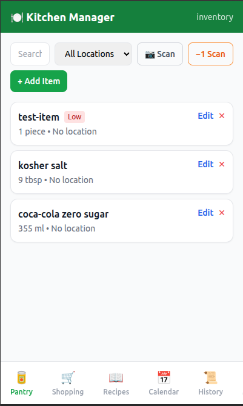
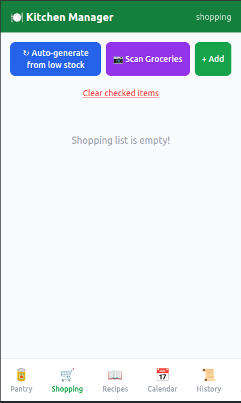
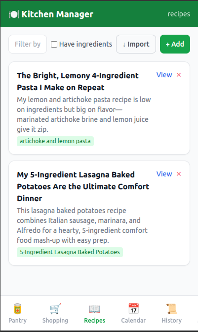
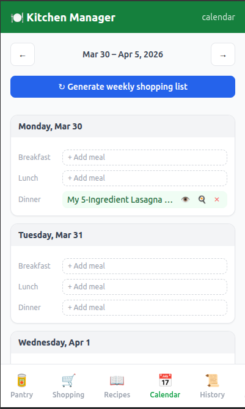
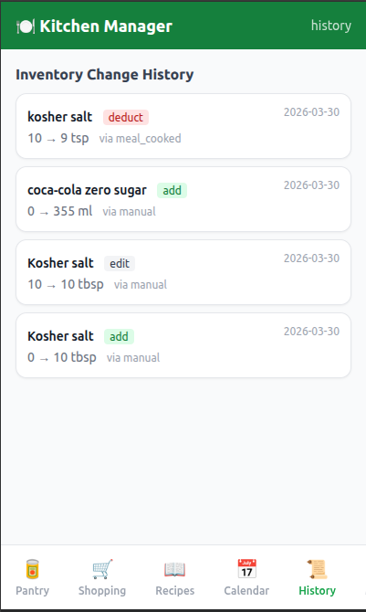

# Kitchen Manager

A self-hosted app for tracking your pantry, planning meals, managing recipes, and generating shopping lists. Runs as a single program — no cloud account required.

## Screenshots

<details>
<summary>Pantry</summary>



</details>
<details>
<summary>Shopping List</summary>



</details>
<details>
<summary>Recipes</summary>



</details>
<details>
<summary>Meal Calendar</summary>



</details>
<details>
<summary>Meal History</summary>



</details>

## Features

- **Pantry tracking** — quantities, units, locations, expiry dates, low-stock alerts
- **Barcode scanning** — use your phone camera to look up or add items
- **Shopping list** — manual items, auto-generated from per-item par levels (restock to par), or pulled from recipes; tick items off and put them away into the pantry in one tap (Bought / Put away checked items)
- **Servings scaling** — scale any recipe up or down with a servings stepper; cooking, shopping lists and the meal calendar scale ingredient quantities to match
- **Recipe import** — paste a URL from any major recipe site; ingredients auto-link to your pantry
- **Recipe archiving** — archive a recipe to hide it without losing its cooking history; deleting a recipe also keeps past cooking history
- **Meal calendar** — plan breakfast/lunch/dinner/snack for the week, edit or move entries; cooking from the calendar deducts ingredients, marks the meal as cooked, and weekly shopping skips it
- **Meal history & cost tracking** — log meals cooked and see weekly/monthly spend
- **Dark mode** — toggle in the header
- **Data backup** — download your database any time from the 💾 button in the header

---

## Quick Start (Docker — recommended)

You'll need [Docker](https://docs.docker.com/get-docker/) installed.

### 1. Download the files

```bash
git clone https://github.com/jpierce42/kitchen_manager
cd kitchen_manager
```

Or download and unzip the source from the Releases page.

### 2. Create your config file

```bash
cp .env.example .env
```

Open `.env` in a text editor. For a basic setup with no login required, you only need to set:

```
DB_PATH=/data/kitchen.db
```

Leave everything else blank for now. You can add Google login later.

### 3. Start the app

```bash
docker compose --env-file .env -f deploy/docker-compose.yml up -d
```

Open **http://localhost:8080** in your browser. That's it.

### 4. Stopping / restarting

```bash
# Stop
docker compose --env-file .env -f deploy/docker-compose.yml down

# Start again
docker compose --env-file .env -f deploy/docker-compose.yml up -d

# View logs
docker compose --env-file .env -f deploy/docker-compose.yml logs -f
```

---

## Accessing from your phone (same Wi-Fi)

Barcode scanning requires HTTPS. To use it on your phone:

1. Find your computer's local IP address (e.g. `192.168.1.42`).
2. Set `SELF_SIGNED_TLS=true` in your `.env` file and restart.
3. Open `https://192.168.1.42:8443` on your phone.
4. Your browser will warn about the certificate — tap **Advanced → Proceed** to continue. This is safe on your home network.
5. When prompted, allow camera access for barcode scanning.

---

## Adding Google Login (optional)

If you want to require a Google account to access the app:

### Step 1 — Create a Google OAuth app

1. Go to [Google Cloud Console](https://console.cloud.google.com/) → **APIs & Services → Credentials**
2. Click **Create Credentials → OAuth 2.0 Client ID**
3. Choose **Web application**
4. Under **Authorised redirect URIs**, add: `https://your-domain.com/auth/callback`
5. Click **Create** and copy the **Client ID** and **Client Secret**

### Step 2 — Generate a session secret

Open a terminal and run:

```bash
openssl rand -hex 32
```

Copy the output — this is your `SESSION_SECRET`.

### Step 3 — Update your `.env`

```
OAUTH_ENABLED=true
GOOGLE_CLIENT_ID=your-client-id-here
GOOGLE_CLIENT_SECRET=your-client-secret-here
SESSION_SECRET=paste-the-64-char-hex-string-here
BASE_URL=https://your-domain.com   # include any path prefix, e.g. https://your-domain.com/kitchen-manager
OAUTH_ALLOWED_EMAILS=you@gmail.com,partner@gmail.com
```

Restart the app after saving.

---

## Backing up your data

All data is stored in a single SQLite file (`kitchen.db`). There are two ways to back it up:

**From the app:** Click the 💾 button in the top-right corner of the app. A `.db` file will download to your computer.

The download is a consistent snapshot (made with SQLite `VACUUM INTO` into a temp file) and is safe to take while the app is running.

**From the server:** a plain `cp` of a live database can be torn, so either stop the app first or use:
```bash
sqlite3 /data/kitchen.db "VACUUM INTO '/backups/kitchen-$(date +%Y%m%d).db'"
```

### Scheduled off-box backups

Example crontab entry (note the escaped `%`), then copy the files to another machine (rsync/rclone) and keep a few rotations:
```
0 3 * * * curl -fsS -o /backups/kitchen-$(date +\%Y\%m\%d).db http://localhost:8080/api/backup
```
If the app sits behind OAuth, hit the container port directly from the host, or use the `sqlite3 ... VACUUM INTO` command above instead.

To restore, stop the app, replace `kitchen.db` with your backup, **delete any `kitchen.db-wal` and `kitchen.db-shm`**, and restart.

The database runs in WAL mode, so `kitchen.db-wal` and `kitchen.db-shm` sit next to `kitchen.db` while the app runs. Schema migrations run automatically on startup; an older binary refuses a newer database.

---

## Configuration reference

All settings go in your `.env` file:

| Variable | Default | Description |
|---|---|---|
| `DB_PATH` | `./kitchen.db` | Where to store the database file |
| `SELF_SIGNED_TLS` | — | Set to `true` to serve HTTPS on port 8443 (needed for phone barcode scanning) |
| `OAUTH_ENABLED` | — | Set to `true` to require Google login |
| `OAUTH_ALLOWED_EMAILS` | — | Comma-separated list of emails allowed to log in |
| `TRUST_FORWARDED_USER` | — | Set to `true` only if the app is reachable solely via Traefik forward-auth; trusts `X-Forwarded-User` for "changed by" history |
| `GOOGLE_CLIENT_ID` | — | From Google Cloud Console |
| `GOOGLE_CLIENT_SECRET` | — | From Google Cloud Console |
| `SESSION_SECRET` | — | Random string for securing login cookies (`openssl rand -hex 32`) |
| `APP_HOST` | — | Public hostname for the Traefik router in `deploy/docker-compose.yml` |
| `BASE_URL` | — | Your app's public URL including any path prefix, e.g. `https://kitchen.example.com` or `https://host/kitchen-manager` |

---

## Units

The app supports 14 units across three categories:

| Category | Units |
|---|---|
| Weight | `g`, `kg`, `oz`, `lb` |
| Volume | `ml`, `L`, `tsp`, `tbsp`, `cup` |
| Count | `piece`, `clove`, `can`, `jar`, `bunch` |

Units in the same category can be converted automatically. Each pantry item has a **preferred unit** — this is used for display and for calculating how much of an item is low.

When a recipe's unit cannot be converted to the pantry item's unit (e.g. cups vs grams), shopping lists add the full amount in the recipe's unit without subtracting stock, and the recipe is not shown as available. The recipe list reports these ingredients under `incompatible_ingredients`.

---

## Recipe import

URL import fetches the page directly and reads its schema.org recipe data. Sites that block automated requests or build the recipe with JavaScript may fail. In that case:

1. Open the recipe in your browser
2. Select all (Ctrl+A), copy (Ctrl+C)
3. Use the **Paste** tab in the Import dialog

For security, URL import refuses URLs that resolve to private, loopback or link-local addresses (LAN devices, localhost, cloud metadata). Use the Paste tab for such pages.

---

## Running without Docker (developers)

```bash
# Plain HTTP on :8080
go run .

# HTTPS on :8443 with self-signed cert
SELF_SIGNED_TLS=true go run .

# Run tests
go test ./...
```

---

## License

MIT — see [LICENSE](LICENSE)

## Frontend dependencies

Alpine.js and ZXing are vendored in `static/vendor/` and Tailwind CSS is pre-built to `static/tailwind.css` (no CDN at runtime). Rebuild CSS after changing classes: `npx tailwindcss@3.4.19 -c tailwind.config.js -i web/tailwind.input.css -o static/tailwind.css --minify`. Asset URLs are relative, so behind the `/kitchen-manager` prefix the app must be opened with a trailing slash (the Traefik config redirects automatically).

## Container notes

- The container runs as UID/GID 10001, so the host data dir must be writable by it: `mkdir -p deploy/data && sudo chown -R 10001:10001 deploy/data`. **Existing deployments:** the DB (and `kitchen.db-wal`/`-shm`) was created by the old root container, so run that chown before redeploying or the app can't open the DB.
- `GET /healthz` (outside auth) returns 200 `ok` when the DB is reachable; the Docker HEALTHCHECK uses it. Check with `docker inspect --format '{{.State.Health.Status}}' <container>`.
